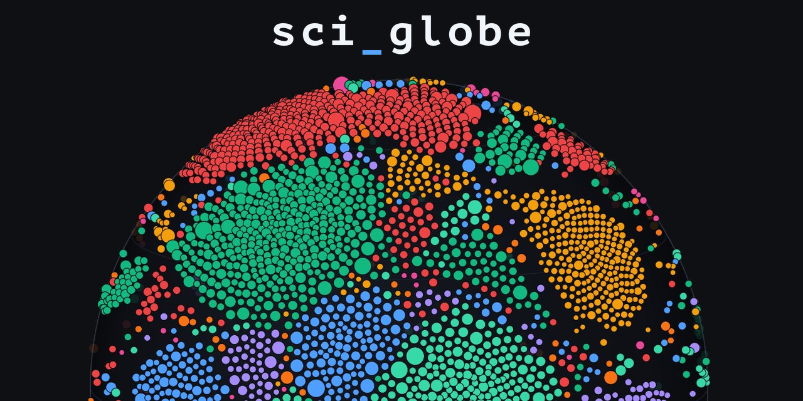

<p align="center">
  
</p>

**sci_globe** is my attempt at trying to create a "knowledge globe" where the layout emerges from connections between papers using a bottom-up approach".
Right now im still developing the project.

# sci_globe CLI Cheatsheet

## 1. Build & Dev Server

```bash
# Compile the CLI binary (release mode for full performance)
cargo build --release --bin sci_globe-cli

# Rebuild the WebAssembly engine for the browser
wasm-pack build --target web --out-dir public/pkg --release

# Start the local dev server with preset & snapshot sync (http://localhost:3000)
python3 serve.py

# Run unit tests and physics convergence checks
cargo test --release
```

## 2. Browser Presets

```bash
# List all saved presets from public/presets.json and built-in presets
./target/release/sci_globe-cli --list-presets

# Run diagnostics on a saved preset (connected papers only)
./target/release/sci_globe-cli --preset "test 3" --only-connected --seed 42
```

## 3. Island & Archipelago Cartography (`--islands`)

```bash
# Detect and analyze all islands (default >= 5 nodes) for a preset
./target/release/sci_globe-cli --preset "test 3" --only-connected --seed 42 --islands

# Show only larger continents/islands (e.g. minimum 15 nodes per island)
./target/release/sci_globe-cli --preset "test 3" --only-connected --seed 42 --islands --min-island 15

# Show even the smallest micro-islands (3 nodes and up)
./target/release/sci_globe-cli --preset "test 3" --only-connected --seed 42 --islands --min-island 3
```

## 4. Experiments & Parameter Overrides

You can load any `--preset` and override individual parameters from the command line:

```bash
# Preset "test 3" with stronger link attraction and leaf degree normalization
./target/release/sci_globe-cli --preset "test 3" --only-connected --link-str 1.2 --deg-norm 0.85 --islands

# Pure bottom-up simulation from scratch (no anchors, no cohesion) for 1000 steps
./target/release/sci_globe-cli --preset pure --only-connected --steps 1000 --islands

# Inspect 10 random papers and their nearest neighbors on the 3D sphere
./target/release/sci_globe-cli --preset "test (goat preset)" --only-connected --inspect 10

# Run a simulation and save its final 3D snapshot for instant loading in the UI
./target/release/sci_globe-cli --preset "test 4" --sample 4000 --dataset-seed 1337 --seed 42 --save-map "Global 4k (test 4)"

# Export the full diagnostic report and CPU profiler breakdown to JSON
./target/release/sci_globe-cli --preset "test 3" --only-connected --dump-json report.json
```

## 5. All `sci_globe-cli` Flags

| Flag | Description |
| :--- | :--- |
| `--preset <NAME>` | Loads a preset from `public/presets.json` (or built-in: `anchors`, `pure`, `cohesion`, `nebula`, `gravity`, `tight`) |
| `--list-presets` | Lists available presets and exits |
| `--list-maps` | Lists saved maps from `public/generated_maps.json` and exits |
| `--save-map <NAME>` | Saves the final globe coordinates (`public/generated/<id>.json`) and entry in `public/generated_maps.json` |
| `--islands` | Runs the island cartographer (3D spatial clusters, purity, TF-IDF keywords, bridges) |
| `--min-island <N>` | Minimum island size to display in the report (default `4`) |
| `--only-connected` | Filters the graph to papers with at least one citation (`deg > 0`) |
| `--all-nodes` | Includes isolated papers with zero citations (`deg == 0`) |
| `--steps <N>` | Number of simulation steps before measuring |
| `--seed <N>` | RNG seed for a reproducible initial layout (e.g. `--seed 42`) |
| `--inspect <N>` | Number of individual nodes for detailed neighbor inspection (default `4`) |
| `--anchor <F>` | Overrides discipline anchor strength (`anchor_strength`) |
| `--cohesion <F>` | Overrides same-discipline cohesion (`subfield_cohesion`) |
| `--nebula <F>` | Overrides cross-discipline repulsion (`nebula_repulsion`) |
| `--link-str <F>` | Overrides citation spring attraction |
| `--deg-norm <F>` | Overrides leaf degree normalization (`degree_norm`) |
| `--pbd <F>` | Overrides XPBD collision stiffness |
| `--dump-json <FILE>` | Writes raw metrics and diagnostics to a JSON file |

